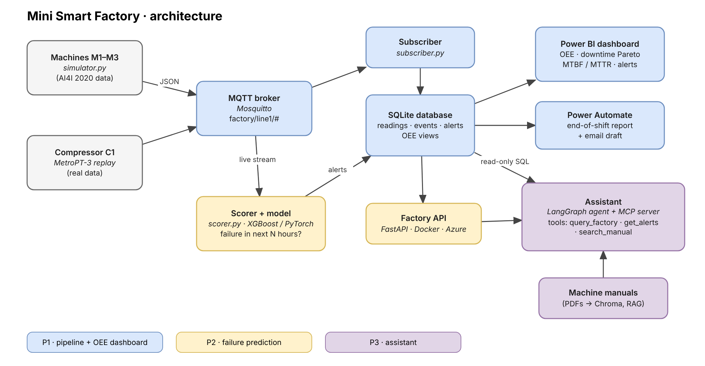

# Mini Smart Factory

An end-to-end Industrial AI system, built step by step during my M.Sc. Industrial AI at Hochschule Albstadt-Sigmaringen:
simulated machines stream sensor data over MQTT, a pipeline stores it, a Power BI dashboard tracks OEE,
a model predicts failures on real compressor data, and an LLM assistant answers questions about the line.

## Parts

| Part | What it does | Status |
|---|---|---|
| [P1 · Data pipeline + OEE dashboard](p1_pipeline/) | Machines → MQTT → SQLite → Power BI (OEE, downtime, MTBF/MTTR) + automated shift report | 🚧 In progress |
| [P2 · Failure prediction](p2_prediction/) | Predicts compressor failures on real MetroPT-3 data, live alerts, API, Docker, Azure | ⏳ Planned |
| [P3 · Shift supervisor assistant](p3_assistant/) | LLM agent (LangGraph) with tools for factory data, alerts and machine manuals; MCP server | ⏳ Planned |

## What is real and what is simulated
- Machine data in P1 is simulated, based on the AI4I 2020 predictive maintenance dataset (UCI).
- Compressor data in P2 is real operating data (MetroPT-3, UCI).

## Tech
Python · MQTT (Mosquitto, paho-mqtt) · SQLite · SQL · Power BI · Power Automate · scikit-learn · PyTorch · FastAPI · Docker · Azure · LangGraph · MCP

## Author
Sahil Ladola · [GitHub](https://github.com/sahil-ladola)
